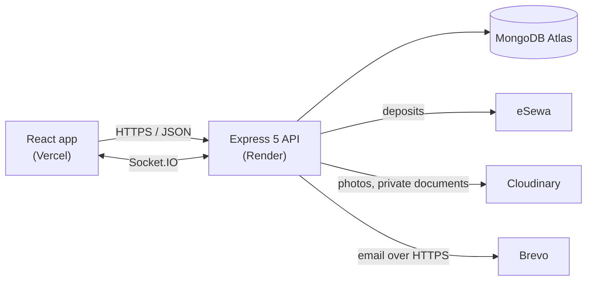

# 🏛️ Venure Backend

[](https://github.com/AaryanBasnet/VenureBackend/actions/workflows/ci.yml)
[](https://github.com/AaryanBasnet/VenureBackend/actions/workflows/uptime.yml)

The REST API behind **[Venure](https://venure.aaryanbasnet.com.np)**, an event-venue platform for Nepal: venue listings, a request-and-quotation flow, eSewa deposits, bookings that cannot double up, real-time chat, and an approval process for new venue owners.

**Live site:** [venure.aaryanbasnet.com.np](https://venure.aaryanbasnet.com.np) · Frontend: [VenureFrontend](https://github.com/AaryanBasnet/VenureFrontend)

> **Try it:** the [login page](https://venure.aaryanbasnet.com.np/login) has one-click **Customer**, **Venue owner** and **Admin** demos. The owner and admin demos are read-only, enforced in `middleware/demoGuard.js`, and the demo admin sees only demo data (`services/demoScope.js`), never a real applicant or customer. The demo venues and photos are made up (the photos are AI-generated illustrations).

### At a glance

| | |
| --- | --- |
| **~1,700** automated tests across the stack | 1,053 backend (real MongoDB), 365 frontend unit, 258 end-to-end |
| **50 → 1** | 50 customers pay for the same slot at the same moment: exactly one booking is created |
| **1,201 ms → 19 ms** | Venue search by guests and amenities (median, 50 concurrent users) |
| **−70% to −86%** | Median latency of the booking and inquiry lists after server-side paging, with responses about 95% smaller |
| **~100 endpoints, 18 models** | About 28,000 lines of application code |

Measured with k6 on a laptop, so treat the absolute numbers as indicative. The tables are in [Engineering details](#-engineering-details).

### Architecture



Routes → validation (Zod) → controllers → **services** (the business rules, no HTTP) → Mongoose models.

### Engineering highlights

Each of these was found by testing or load testing, fixed, and checked again. The numbers are in [docs/PERFORMANCE.md](docs/PERFORMANCE.md).

- **A double booking is impossible, not just unlikely.** The guarantee lives in the database: a partial unique index (`active_slot_keys_unique`) on the slot keys of live bookings. In a race test, 50 customers verify a payment for one slot at once and exactly 1 booking is created (49 get a conflict).
- **A payment settles exactly once.** The server checks eSewa's signature, matches the payment to the attempt it created, asks eSewa's status API whether it is `COMPLETE`, and only then books. A callback replayed 20 times in parallel gives 1 booking and 1 payment record. If a customer pays for a slot taken a moment earlier, the attempt is flagged `refund_due` for a manual refund (eSewa has no refund API).
- **Load testing found a real bug.** 51 parallel "favorite" toggles stored the same venue 11 times (a read-modify-write on the user document). An atomic update fixed it: exactly 1 now.
- **Venue search went from 1,201 ms to 19 ms.** The "guests and amenities" filter used to aggregate over every hall in the database on each request. The capacity, minimum price and hall count now live on the venue and are kept in sync by hooks, every index is declared in the models, and public reads sit behind a short-lived cache.
- **The slowest lists got 70–86% faster.** Owner bookings took about 5.9 s at 50 users and returned 411 KB. The four booking and inquiry lists now come a page at a time, with the tab filter and the size of every tab computed on the server: 0.8 s and 11 KB.
- **New venue owners go through approval.** Owners apply with their business documents and photos (the documents are stored privately on Cloudinary and reachable only through a 5-minute signed link for an admin). On approval the owner account is created with no password and a one-time hashed link, valid 7 days, is emailed. Public sign-up creates customers only, and admins exist only through `scripts/create-admin.js`.
- **Built for how Nepal books events.** Quotations are priced per plate and per shift, never per hour. Money is stored in paisa. Dates follow Kathmandu time whatever time zone the server runs in.
- **A public demo that is safe to hand to anyone.** Three one-click accounts, no password. The server refuses every change from a demo account (one exception: the demo customer may send a request, only to a demo venue, five a day, deleted after 24 hours). A demo admin is scoped to records flagged `isDemo`, including when it opens a request or quotation by id. A test calls every admin read as the demo admin and fails if a real person's name or email appears.
- **Security:** HttpOnly cookie sessions, rate limits, Helmet, a CORS origin allow-list as the CSRF defence, and request values wrapped in `$eq` so user input cannot inject a query operator (CodeQL alerts on this are fixed).

**Testing:** 1,053 tests run against a real MongoDB (`mongodb-memory-server` locally, a service in CI) on every push and pull request.

This repository is the backend only. The React frontend lives in a separate repository.

---

## ✨ What it does

A customer sends an **inquiry** for a date and a shift. The venue answers with a **quotation**. When the customer accepts, they pay a **deposit on eSewa**, and only a verified payment creates the **booking**. The balance is paid at the venue and recorded by the owner.

- **Roles:** Customer, VenueOwner, Admin.
- **Venues and halls:** a venue has a type (banquet or party palace, hotel or resort, heritage or traditional) and one or more halls, each with a kind of space. A venue cannot go live without a hall, and the last hall of a live venue cannot be removed.
- **Reasons:** a venue must say why it declines a request. A customer may say why they cancel or turn a quotation down.
- **Chat and notifications** over Socket.IO, with read receipts.
- **Reviews, favorites, newsletter, contact form, landing page content and an admin dashboard.**

## 🛠 Tech stack

Node.js 22 · Express 5 · MongoDB with Mongoose · JWT in HttpOnly cookies (access and refresh) · Socket.IO · Zod · Cloudinary · eSewa · Brevo or Gmail for email · Winston logging · Helmet and rate limits · Jest, Supertest and mongodb-memory-server · k6

## 🔌 API overview

All routes are under `/api`. Responses look like `{ "success": true, "data": ... }`.

| Prefix | What is there |
| --- | --- |
| `/auth`, `/password` | Register (customers), login, refresh, Google sign-in, set password, reset password |
| `/venues`, `/spaces` | Browse and filter venues, venue details, owner venue and hall management, hall photos, admin status |
| `/venue-applications` | Apply to list a venue, email check, admin review, approve, reject, resend link |
| `/inquiries`, `/quotations` | Requests, quotations, accept, decline and cancel with reasons, attachments |
| `/payment`, `/bookings` | eSewa signing and verification, booking lists (paged), cancel, complete, settle balance, earnings |
| `/chats` | Conversations, messages, unread count (live events over Socket.IO) |
| `/user`, `/user/favorites`, `/notification`, `/contact`, `/newsletter`, `/landing`, `/admin` | Profile, favorites, notifications, contact form, newsletter, landing page content, admin dashboard and activity |

Booking and inquiry lists take `?page`, `?limit` and `?group` and return `{ items, total, page, pages, counts }`, with the size of every tab in `counts`.

## 🏗️ Project structure

```
route/         what URL maps to what, who may call it
validators/    Zod schemas
controller/    thin HTTP adapters: take the request apart, call a service, reply
services/      the actual rules: who may cancel, how a refund is worked out, what a quotation must contain
model/         Mongoose schemas, including the indexes the app relies on
middleware/    auth, roles, uploads, rate limits
socket/        Socket.IO setup and events
scripts/       create-admin, seed, one-off migrations
test/          Jest suites and helpers
docs/          DEPLOY.md and PERFORMANCE.md
```

Rules live in `services/`, which is where the tests aim, so a change to a refund or a quotation rule shows up as a failing test.

## 🧭 Design decisions

- **Guarantees in the database, not the code.** A race between two requests cannot be solved reliably in application code, so double booking is stopped by a unique index and payments settle through a single conditional update.
- **Per plate and per shift.** Venues in Nepal do not charge by the hour, so neither does Venure.
- **Owners apply, they do not sign up.** A public owner sign-up would let anyone list a fake venue. Approval with documents keeps the listings real.
- **Demo accounts are enforced on the server.** Hiding a button protects nothing, so the read-only rule lives in the auth middleware and covers every route, including ones added later.
- **Email over HTTPS.** Render's free plan blocks SMTP ports, so email goes through Brevo's API, with Gmail SMTP as a fallback.
- **Refunds by hand.** eSewa has no refund API, so a cancellation records what is owed and Venure pays it back, rather than pretending it is automatic.

## ⚙️ Getting started

You need Node.js 22 and a MongoDB database (local or Atlas).

```bash
git clone https://github.com/AaryanBasnet/VenureBackend.git
cd VenureBackend
npm install
cp .env.example .env     # then fill it in
npm run dev              # nodemon; use `npm start` in production
```

Create the first admin (the password is asked for, never printed or saved):

```bash
node scripts/create-admin.js
```

`npm run seed` fills a **local development** database with sample data and uses a well-known password. Never run it on a live database.

### Environment variables

`.env.example` lists the basics. The full set, with notes for production, is in [docs/DEPLOY.md](docs/DEPLOY.md).

| Variable | Needed | What it is |
| --- | --- | --- |
| `DB_URL` | yes | MongoDB connection string |
| `JWT_SECRET`, `REFRESH_TOKEN_SECRET` | yes | Two different random strings. The server refuses to start if they match |
| `FRONTEND_URL` | yes | Allowed site origin(s), comma separated. Used for CORS, cookies, sockets and the eSewa return URLs |
| `PORT` | no | Defaults to 5050 |
| `CLOUDINARY_CLOUD_NAME`, `CLOUDINARY_API_KEY`, `CLOUDINARY_API_SECRET` | yes | Photos and application documents |
| `ESEWA_MERCHANT_CODE`, `ESEWA_SECRET_KEY`, `ESEWA_FORM_URL`, `ESEWA_STATUS_URL` | production | Blank outside production falls back to eSewa's public sandbox merchant |
| `BREVO_API_KEY`, `MAIL_FROM_EMAIL`, `MAIL_FROM_NAME` | for email on Render | Brevo over HTTPS |
| `GMAIL_USER`, `GMAIL_PASS` | alternative | Gmail SMTP when no Brevo key is set |
| `GOOGLE_CLIENT_ID` | no | Google sign-in. Must match the frontend's `VITE_GOOGLE_CLIENT_ID` |

## 🧪 Testing

```bash
npm test
```

48 suites and 1,053 tests run against a real MongoDB, not mocks. They cover the booking race (many requests for one slot), eSewa replay, cancellation and refund boundaries, Kathmandu month boundaries, inquiry and quotation rules, the applications flow, uploads, chat, the model indexes and cross-site requests. CI runs the same suite on every push and pull request, after a require-path case check (Linux is case sensitive) and a check that the app boots.

## 📊 Engineering details

<details>
<summary><b>Load test results</b> (k6, 50 concurrent users, 3,200 venues, 40,000 bookings, 30,000 inquiries, 20,000 reviews)</summary>

| Endpoint | Median before → after | Throughput before → after |
| --- | --- | --- |
| Public venue list and filters | 243–386 ms → about 20 ms | 124–197 → about 2,300–2,500 req/s |
| Venue search by guests and amenities | 1,201 ms → 19 ms | 38 → 2,494 req/s |
| Venue detail | 122 ms → 18 ms | 406 → 2,634 req/s |
| Owner reviews | 1,643 ms → 331 ms | 26 → 120 req/s |
| Admin monthly earnings | 583 ms → 84 ms | 82 → 586 req/s |
| Notifications (customer, owner) | 385, 414 ms → 154, 157 ms | 104, 95 → 265, 258 req/s |
| Customer inquiries list | 1,794 ms → 546 ms | 20 → 73 req/s |
| Customer bookings list | 3,130 ms → 606 ms | 12 → 65 req/s |
| Owner inquiries list | 4,125 ms → 855 ms | 9 → 46 req/s |
| Owner bookings list | 5,871 ms → 798 ms | 6 → 50 req/s |

What produced the gains: indexes declared in the models (27–60% on their own, and a test uses `explain` to prove the hot queries never scan the whole collection), denormalised fields, a short-lived cache for public reads, and server-side paging with per-tab counts (response sizes fell from 137–411 KB to 11–16 KB).

Honest reading: most of the public-browse gain is the cache, which helps repeated identical reads. One machine runs the load generator, the database and the server, so expect about ±25% noise. Full method and every endpoint: [docs/PERFORMANCE.md](docs/PERFORMANCE.md).

</details>

<details>
<summary><b>Concurrency and integrity checks</b> (real HTTP requests fired at the same instant)</summary>

| Scenario | Result |
| --- | --- |
| 50 customers pay for the same slot | 1 booking, 49 conflicts |
| One eSewa callback replayed 20 times in parallel | 1 booking, 1 payment record |
| 30 sign-ups with the same email (case variants too) | 1 account |
| 20 reviews of one booking at once | 1 review |
| 30 chat messages at once | 30 messages, 30 notifications, preview ends on the newest |
| 51 parallel favorite toggles | exactly 1 stored (a load test found 11 duplicates before the fix) |

Open item: in the 50-way slot race, 47 of the 49 losers were flagged `refund_due`. The other 2 are not explained yet.

</details>

<details>
<summary><b>Process</b></summary>

About 110 commits, 15 merged pull requests with CI on every push, and CodeQL security alerts reviewed and fixed.

</details>

## 🚀 Deployment

The API is a plain Node server (`node server.js`) and the repository has a `Dockerfile`. A GitHub Actions workflow checks the site, `/api/health` and `/api/ready` (which pings the database) every 10 minutes. [docs/DEPLOY.md](docs/DEPLOY.md) covers environment variables, the health check, cookies across domains, venue applications, the first admin and testing eSewa. [docs/PERFORMANCE.md](docs/PERFORMANCE.md) has the load-test results and what was changed because of them.

## 🚧 Known limits

- Payments run on eSewa's sandbox until live keys are set. The sandbox test wallet is small, so large deposits fail there.
- Refunds are recorded and paid back by hand.
- Email from an unverified free sender may land in spam until the Brevo domain is authenticated.

## 🔗 Related repositories

- [VenureFrontend](https://github.com/AaryanBasnet/VenureFrontend): the React app that uses this API.

## 📄 License

Source-available under the [PolyForm Noncommercial License 1.0.0](LICENSE). You can read, run and learn from the code. Commercial use is not allowed.

## 📬 Author

Aaryan Basnet · [basnetaryan1011@gmail.com](mailto:basnetaryan1011@gmail.com) · [LinkedIn](https://www.linkedin.com/in/basnet-aryan-4511a22a4/)
